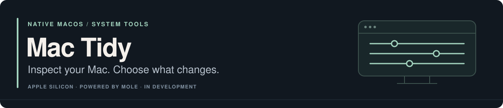

<p>
  
</p>

Mac Tidy brings storage analysis, cleanup previews, app removal, and system health into a native macOS interface. It bundles a modified [Mole](https://github.com/tw93/Mole) engine, with selection, confirmation, progress, and cancellation handled in Mac windows.

[Build](#build) · [Features](#features) · [Safety](#safety) · [Project status](PROJECT_STATUS.md) · [Contribute](CONTRIBUTING.md)

> **In development — build from source.** No public binary release is available yet. Targets **Apple silicon Macs running macOS 14+**. Local preview packages are ad-hoc signed and **not Apple-notarized**.

## Features

| Task | What you can do |
| :--- | :--- |
| Understand storage | Analyze folders, inspect large items, reveal them in Finder, and move exact selections to Trash. |
| Review cleanup | Preview caches, logs, temporary files, and abandoned app leftovers; adjust cleanup protections before applying changes. |
| Remove applications | Select an app by its exact path and review related files. Use Trash by default or explicitly choose permanent removal. |
| Maintain the system | Preview supported maintenance tasks, inspect optimization protections, and manage Touch ID support for administrator authentication. |
| Inspect system health | View storage, memory, battery, network, process, and other system data. |
| Clean up development work | Find selected project build artifacts and installer archives, and review or export operation history. |

## Build

You will need:

- An Apple silicon Mac running macOS 14 or later.
- Xcode with Swift 5.10 or later.
- Go 1.25 or later.

```sh
git clone https://github.com/chai-in/Mac-Tidy.git
cd Mac-Tidy
./scripts/build-app.sh
```

The packaging script runs Swift and Go tests, builds the `arm64` app and bundled engine, embeds license notices, signs the local preview ad hoc, checks the assembled bundle, and exercises the packaged engine. It writes these outputs to `dist/`:

- An **unnotarized DMG** and **app ZIP**.
- A **corresponding-source ZIP**, including the Go dependency source needed to rebuild the engine.
- `SHA256SUMS.txt` for checking the packaged files.

macOS may block the first open. For a local build you chose to trust, use **System Settings → Privacy & Security → Open Anyway**, then confirm **Open**. Public binary releases should use Developer ID signing and Apple notarization.

For native app tests without packaging:

```sh
swift test
```

See [CONTRIBUTING.md](CONTRIBUTING.md) for engine tests and bridge checks, and [PROJECT_STATUS.md](PROJECT_STATUS.md) for the recorded verification history and distribution limits.

## Safety

The workflow is **inspect → select → preview → confirm**. Scans and previews do not receive permission to change files. Actions that modify files require a native confirmation and an engine-side authorization check.

- **Exact selections:** uninstall, purge, and analyzer actions pass the selected paths to the engine, which revalidates them before changing anything.
- **Recoverable removal:** supported actions use Trash. Permanent operations are explicitly labeled.
- **Cancellation:** stop long-running work from the toolbar or Activity panel.
- **Quiet progress:** Activity output opens only when you choose **Show Activity**. It remains available while hidden; errors still appear in native alerts.
- **Bundled runtime:** packaged apps execute their bundled engine. Development builds can use `MAC_TIDY_EXECUTABLE` or an installed `mo` only when the bundle is absent.

Complete scans need **Full Disk Access**. On first open, Mac Tidy explains the permission and opens the relevant macOS settings. You grant access yourself; limited-access use remains available.

## How it is put together

The Swift app provides the native interface and controls the user's selections. The modified Mole engine owns scanning, protected-path checks, filesystem operations, and operation history. Go helpers supply analysis and system-status data.

Mac Tidy is an independent application built around existing open-source work. The [engine modification notice](Vendor/Mole/MODIFICATIONS.md) documents the integration; upstream authorship and licenses remain intact.

## Resource use

Status refresh runs while the Status screen is active and pauses for other work. The app reuses a warm collector, streams activity in bounded batches, and loads large result lists in pages. These choices keep the interface responsive without retaining an ever-growing log in memory.

See [PERFORMANCE.md](PERFORMANCE.md) for the specific limits, measurements, and reproduction steps. Packaging checks and recorded tests do not replace testing a preview on your own Mac.

## Help and contribution

Reproducible bug reports, focused interface improvements, and documentation fixes are welcome. Start with [contributing](CONTRIBUTING.md), check the [project status](PROJECT_STATUS.md), or [open an issue](https://github.com/chai-in/Mac-Tidy/issues). Report suspected vulnerabilities through [SECURITY.md](SECURITY.md).

## Provenance and license

Mac Tidy vendors Mole `V1.53.0` at upstream commit `1b9023b5f151c2d963bbcb9cb658f4824137b8aa`. The native app and modified engine are distributed under [GNU GPL v3 only](LICENSE).

The project uses its own name and icon and is not endorsed by or affiliated with Mole. The upstream name identifies the bundled engine; its [trademark policy](Vendor/Mole/TRADEMARK.md) and original notices are preserved. Contributions use the same project license.
